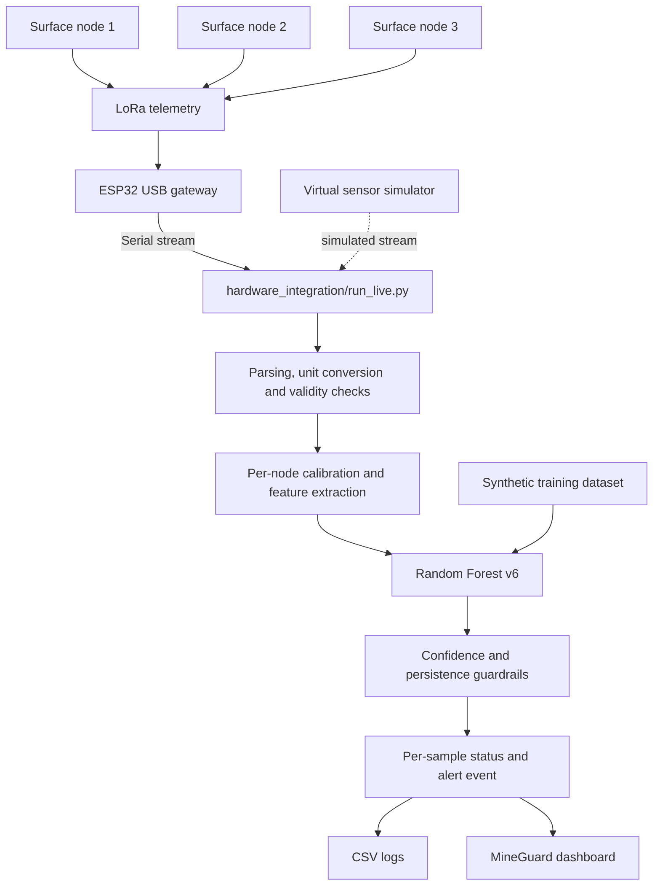

# MineGuard

**Low-cost, multi-node surface sensing and early-warning prototype for mine-subsidence monitoring.**

MineGuard combines a three-node ESP32/LoRa sensing concept with a Python data-processing and machine-learning pipeline and a browser-based monitoring dashboard. The software converts incoming node records into validated per-node features, runs a Random Forest v6 classifier, applies confidence/persistence rules, and can send the resulting status to the dashboard.


## Contents

- [System overview](#system-overview)
- [What the current software does](#what-the-current-software-does)
- [Repository layout](#repository-layout)
- [Hardware overview](#hardware-overview)
- [Machine-learning model and evaluation](#machine-learning-model-and-evaluation)
- [Run the dashboard](#run-the-dashboard)
- [Run the Python pipeline](#run-the-python-pipeline)
- [Run the virtual simulator](#run-the-virtual-simulator)
- [Run tests](#run-tests)
- [Telemetry format and configuration](#telemetry-format-and-configuration)
- [Logs and calibration](#logs-and-calibration)
- [Known scope and limitations](#known-scope-and-limitations)
- [Project resources](#project-resources)
- [License](#license)

## System overview



The Python pipeline and dashboard are separate components. The pipeline handles serial/replay input, sensor conversion, calibration, model inference and guardrails. The Next.js dashboard provides the operator-facing interface and Demo Mode. Demo Mode is not itself a physical-sensor test.

### Status outputs

The current guardrail code uses four statuses:

| Status | Meaning |
|---|---|
| `NORMAL` | The model's top class is `normal`. |
| `DECOY` | The top class is the configured benign `decoy_seismic` class. It is logged without a subsidence-risk alert. |
| `POSSIBLE` | A risk class is the top prediction, but the confidence or consecutive-sample condition for confirmation has not been met. |
| `CONFIRMED` | The same risk class has met the configured confidence and persistence conditions; an alert event is fired. |

These are pipeline statuses. The model itself has three classes: `normal`, `decoy_seismic`, and `subsidence_precursor`.

## What the current software does

- Reads serial input or replays saved raw serial lines.
- Parses node records and converts supported accelerometer, gyroscope and ultrasonic distance units.
- Calibrates each node's resting tilt/displacement reference and noise floors.
- Rejects readings outside configured physical sanity limits before model inference.
- Constructs the eight model features in the order expected by the v6 artifact.
- Runs Random Forest v6 inference.
- Applies confidence and consecutive-sample persistence rules to reduce alerts caused by a single model vote.
- Writes per-sample CSV output and diagnostic information.
- Checks for stale nodes and reports repeated dropped windows as a sensor-fault condition.
- Synchronizes pipeline state to the dashboard when dashboard synchronization is enabled.
- Provides a virtual simulator that feeds simulated sensor streams through the same Python pipeline.

## Repository layout

```text
.
├── README.md
├── clean_data/
│   └── README.md
├── hardware_integration/
│   ├── README.md
│   ├── FORMAT_AUDIT.md
│   ├── config.py
│   ├── sensor_conversion.py
│   ├── feature_engine.py
│   ├── inference_pipeline.py
│   ├── guardrails.py
│   ├── run_live.py
│   ├── audit_format.py
│   └── test_pipeline_units.py
├── mineguard-final/
│   └── README.md
├── model/
│   └── README.md
├── synthetic/
│   └── README.md
└── virtual_simulator/
    ├── README.md
    ├── backend/
    └── frontend/
```

| Path | Purpose |
|---|---|
| `hardware_integration/` | Serial/replay sources, sensor conversion, validation, per-node calibration, streaming features, inference, guardrails, logging and pipeline tests. |
| `model/` | Random Forest v6 model artifact, training/evaluation scripts, metrics and model-specific documentation. |
| `synthetic/` | Generated sensor-like dataset, event labels and scripts used to train and evaluate the model. These records are synthetic, not measurements from the physical prototype. |
| `mineguard-final/` | Next.js dashboard interface, Demo Mode, API contracts and dashboard-side state presentation. This package does not itself contain the physical LoRa gateway service or trained model inference engine. |
| `virtual_simulator/` | Local interactive simulator that generates a sensor-like stream and feeds it into the existing Python pipeline. |
| `clean_data/` | Reference-data audit and derived files from a public mine dataset. These files are methodological reference material, not MineGuard hardware logs or the v6 training dataset. |

Each component README contains deeper implementation notes. This root README is the project-wide starting point; the nested READMEs should be maintained as component documentation.

## Hardware overview

The prototype design uses multiple ESP32-based surface nodes, SX1278 LoRa radios, MPU-9250-class motion sensing and HC-SR04 ultrasonic ranging, with a USB-connected ESP32 gateway. Refer to the team's actual wiring/schematic package for the as-built electrical connections and pin mapping.

- **IMU:** provides the motion data used to derive tilt and vibration-related features.
- **Ultrasonic sensor:** reports distance to a target. Converting changes in that distance into physical surface displacement depends on mounting geometry, a calibrated reference and the configured sign/units.
- **Temperature sensor:** a DS18B20 is listed in the prototype hardware inventory, but temperature is not one of the eight Random Forest input features in the current pipeline.
- **Crack input:** the model schema contains `crack_signal`, but the current three-node feature engine sets this feature to `0`; the current live pipeline does not receive an independent crack-sensor measurement.
- **Radio/gateway:** the Python pipeline reads the gateway's serial output. Its default serial schema is configurable and must match the actual firmware output.

The pin mapping should be taken from the verified, as-built schematic and firmware—not inferred from a generic ESP32 diagram.

## Machine-learning model and evaluation

### Model and features

The configured artifact is `model/random_forest_model_v6.joblib`. The model uses eight features, in this exact order:

1. `tilt_deg`
2. `vibration_rms`
3. `displacement_mm`
4. `crack_signal`
5. `vibration_duration`
6. `tilt_vibration_correlation`
7. `displacement_persistence`
8. `tilt_deviation_from_node_baseline`

The model was trained on `synthetic/simulated_mesh_data_v6_with_external.csv`. The repository's model documentation reports 103,960 dataset rows, 60,644 training rows and 43,158 held-out test rows. The test set is strongly imbalanced: 43,017 `normal`, 20 `decoy_seismic`, and 121 `subsidence_precursor` samples.

### Reported held-out synthetic results

| Test-set class | Precision | Recall | F1 score | Support |
|---|---:|---:|---:|---:|
| `normal` | 99.88% | 100.00% | 99.93% | 43,017 |
| `decoy_seismic` | 86.36% | 95.00% | 90.48% | 20 |
| `subsidence_precursor` | 100.00% | 57.02% | 72.63% | 121 |
| **Overall accuracy** | — | — | — | **99.87%** (43,158 samples) |

These values are the metrics documented for the v6 Random Forest on its held-out **synthetic** test set. The high overall accuracy is affected by the large number of normal samples. For the precursor class, 100% precision occurs alongside 57.02% recall: the evaluated model missed some precursor samples. These numbers do not establish performance on a real mine, and they should not be described as field-validated prediction accuracy.

To reproduce or inspect the evaluation, see `model/README.md`, `model/metrics_v6.json` and `model/build_model_v6.py`.

## Run the dashboard

**Requirements:** Node.js and npm compatible with the versions used by the project.

```bash
cd mineguard-final
npm install
npm run dev
```

Open [http://localhost:3000](http://localhost:3000).

Useful checks:

```bash
npm run typecheck
npm run build
```

The dashboard includes Demo Mode for exercising UI states with simulated observations. Demo Mode is useful for reviewing the interface; it is not evidence that physical sensors or the radio link are working.

## Run the Python pipeline

**Requirements:** Python 3.10 or newer is recommended. The pipeline uses NumPy, pandas, scikit-learn and joblib; live serial input uses pyserial.

From the repository root, create and activate a virtual environment.

**Windows (PowerShell):**

```powershell
py -m venv .venv
.\.venv\Scripts\Activate.ps1
python -m pip install --upgrade pip
python -m pip install numpy pandas scikit-learn joblib
python -m pip install -r hardware_integration/requirements.txt
```

**macOS/Linux:**

```bash
python3 -m venv .venv
source .venv/bin/activate
python -m pip install --upgrade pip
python -m pip install numpy pandas scikit-learn joblib
python -m pip install -r hardware_integration/requirements.txt
```

### Before connecting physical hardware

The configured parser defaults assume a record with node identity, accelerometer axes, gyroscope axes and distance. Do not assume this matches every firmware build. First probe the actual serial stream:

```bash
cd hardware_integration
python audit_format.py --probe COM5 --lines 300
```

Replace `COM5` with the actual port. Review `FORMAT_AUDIT.md` and make sure the serial columns, sensor units, accelerometer range, distance unit and displacement sign match the firmware and physical mounting. If needed, use a JSON configuration override with `--config my.json`.

This step matters because a parser accepting a line does not, by itself, prove that the resulting values have correct units or physical meaning.

### Start live or replay processing

Start the dashboard in one terminal as described above. In a second terminal, from the repository root:

```bash
cd hardware_integration
python run_live.py --port COM5
```

Useful options:

```bash
python run_live.py --port COM5 --baud 115200
python run_live.py --port COM5 --recalibrate
python run_live.py --replay path/to/saved_raw_log.txt
python run_live.py --port COM5 --no-dashboard
```

- Replace `COM5` with the serial port on the computer.
- Use `--recalibrate` after moving/reinstalling nodes or when the saved calibration no longer matches the installation.
- `--replay` processes a saved raw log instead of reading a live serial port.
- The default sample profile is `bench`; the `field` profile uses the training-time 15-minute sample cadence. The bench cadence compresses time relative to the model's training data, so its alert timings must not be interpreted as a validated field warning horizon.
- The pipeline writes per-sample CSV records under `hardware_integration/logs/` by default and saves node calibration in `hardware_integration/calibration.json`.

## Run the virtual simulator

The virtual simulator produces simulated node readings and passes them through the existing inference pipeline. It does not emulate calibrated physical sensors or validate the hardware's measurement accuracy.

Install its dependencies and start the backend from the repository root:

```bash
python -m pip install -r virtual_simulator/requirements.txt
python virtual_simulator/backend/app.py
```

Follow the URL printed by the application. To run the simulator's automated checks:

```bash
python virtual_simulator/backend/selftest.py
```

See `virtual_simulator/README.md` for controls, presets and additional details.

## Run tests

The Python pipeline tests are in `hardware_integration/`.

```bash
cd hardware_integration
python -m unittest test_pipeline_units
```

The hardware-integration README also documents static/no-movement and vibration-only test harnesses. Use the appropriate source mode and test instructions in that README. A test run using a simulator or saved replay validates the software path under those inputs; it does not validate the physical sensor, radio link or mounting.

## Telemetry format and configuration

The default `PipelineConfig` in `hardware_integration/config.py` includes:

- Serial baud rate: `115200`
- Default assumed columns: `node, ax, ay, az, gx, gy, gz, dist`
- Distance unit: `cm`
- Admissible distance range: `2.0–400.0 cm`
- Bench model-sample window: `2 seconds`
- Confirmation confidence: `0.70`
- Bench persistence window: `8 seconds` (four consecutive 2-second windows by default)

These are configuration defaults, not universal hardware specifications. Check the installed sensor module, firmware output, full-scale settings and mounting before using the values on a physical setup.

The pipeline rejects out-of-range or otherwise physically implausible readings before model inference. The raw firmware console output and the model-frame data produced after parsing/conversion are different stages; use the logs and `FORMAT_AUDIT.md` when troubleshooting a mismatch.

## Logs and calibration

The live runner can write:

- Per-sample CSV containing model features, predicted probabilities, top class, status, streak and alert events.
- Raw serial logs when `--raw-log` is supplied.
- Calibration data in `hardware_integration/calibration.json`.
- Diagnostic/suspicious-reading logs under the hardware-integration log directory.

Keep the raw input alongside the processed CSV when investigating a reading or reproducing an alert. Do not edit raw logs to make them agree with the model output.

## Known scope and limitations

- Model training and reported v6 evaluation use synthetic data. Field performance has not been established by those metrics.
- The dashboard's Demo Mode uses simulated observations.
- The current feature engine sets `crack_signal` to zero because the documented three-node hardware has no separate crack sensor input.
- The current model is trained at a 15-minute sample cadence. The default 2-second bench profile compresses time for demonstrations; it is not a validated field warning horizon.
- The repository's software guardrails reduce alerts from isolated model votes, but they are not a certified mine-safety system.
- MineGuard is a prototype decision-support layer and is not a replacement for established mine surveying, geotechnical assessment or statutory safety procedures.

## Project resources

- **Source code:** [MineGuard GitHub repository](https://github.com/Divyanshi-gupta1/SIH_MINE_SUBSIDENCE)
- **Prototype demonstration:** [Watch the project demonstration](https://drive.google.com/file/d/1Xd0NuU_oMaX4RK9SaTbXG6x7QjB8zqFi/view?usp=drivesdk)
- **Hardware integration notes:** [`hardware_integration/README.md`](hardware_integration/README.md)
- **Format and unit audit:** [`hardware_integration/FORMAT_AUDIT.md`](hardware_integration/FORMAT_AUDIT.md)
- **Model details and metrics:** [`model/README.md`](model/README.md)
- **Synthetic data documentation:** [`synthetic/README.md`](synthetic/README.md)
- **Dashboard documentation:** [`mineguard-final/README.md`](mineguard-final/README.md)
- **Virtual simulator documentation:** [`virtual_simulator/README.md`](virtual_simulator/README.md)
- **Reference-data documentation:** [`clean_data/README.md`](clean_data/README.md)

The circuit schematics and associated hardware-design files are maintained in the accompanying project documentation package. Include them with the project submission so a reviewer can inspect the actual electrical design.

## License
MIT-licensed
